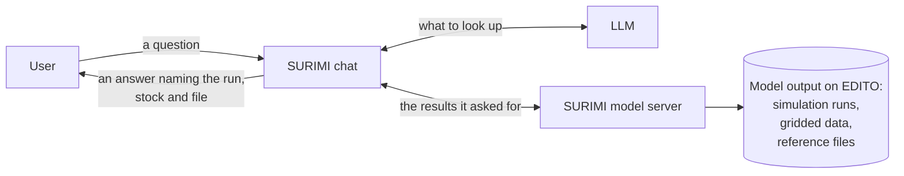

# SURIMI model server

SURIMI-model-mcp is the server that answers questions about what the SURIMI simulation models produced. It reads the results the models leave behind, which are the simulation runs and their output files, the stock assessments inside them, and gridded ocean data such as biomass on a map grid. It is the deliverable D3.9, the second of the two SURIMI servers.

Users do not talk to the server directly. They type their question in the SURIMI chat (SURIMI-vllm-ui), and an LLM served by SURIMI-vllm reads the question, calls the server's tools and writes the answer. The chat and the LLM service are supporting parts and not part of the deliverable. They are needed so that people can use the server in their own words.

A policy officer can ask, for instance, whether hake is overfished in the latest output run. The LLM first lists the runs and then asks the server for the stock status of the latest one. The server reads the output file and calculates the numbers, and the LLM writes the answer and names the run, the stock and the file it came from. The numbers are calculated by the server and not by the LLM.

The server does not run simulations, because a SURIMI experiment takes one to two days. It answers about runs that already exist. The gridded calculations (ranking, time series, comparison of periods and trend) return a signed calculation record, called a receipt in the code, which anyone can use to check the number later.

Its sibling, [SURIMI-data-mcp](https://github.com/SURIMI-Project/SURIMI-data-mcp), is the deliverable D3.7 and answers from observed data such as catches, landings and fleet economics.

## What you can ask

Questions the server is built for:

- "Which simulation runs are there, and what is each one about?"
- "What is the stock status of hake in the latest output run?"
- "How has the biomass of small demersal fish changed in the western Mediterranean?"
- "What does the species code HKE mean?"
- "What information is stored in SURIMI's NetCDF output file?"

## How it works



1. A user asks a question in the SURIMI chat.
2. The LLM decides what it needs, for example the list of runs, one run's files, a stock's status or a trend over a region.
3. The chat calls the server's tools, and the server finds the run or file and calculates the result.
4. The LLM writes the answer and names the run, the stock and the file it came from.

## Reading stock status

For a fish stock the server reports two numbers that fisheries scientists use.

- **B/Bmsy** is the stock's biomass compared with the level that gives the maximum sustainable yield. A value below 1 means the stock is overfished.
- **F/Fmsy** is the fishing pressure compared with the level that gives the maximum sustainable yield. A value above 1 means the stock is fished harder than that level, which is called subject to overfishing.

Together they place the stock in one of four groups of the Kobe plot, which are healthy, overfished, subject to overfishing, or both. For a CMSY++ stock assessment the server also reports the uncertainty range. For the stocks in a run's output file it reports none, because the file does not hold one.

## What it does not do

- It does not run simulations or change their settings.
- It does not change any file and only reads.
- It does not read files that users upload.

## Try it

- **On EDITO:** open the [SURIMI chat](https://project-surimi-vllm-ui.lab.dive.edito.eu) and sign in.
- **In another assistant:** the server speaks the Model Context Protocol (MCP), the standard way to give an AI assistant access to a tool, so any MCP-compatible client can attach it at `https://project-surimi-surimi-model-mcp.lab.dive.edito.eu/mcp`.

## Learn more

| Document | For whom | What it holds |
|---|---|---|
| [docs/tools.md](docs/tools.md) | Anyone | Each of the server's 26 tools and what it does, with an example question |
| [docs/behaviour.md](docs/behaviour.md) | Developers writing a client | Guarantees and edge cases: read-only access, stale listings, truncated files |
| [model_mcp_architecture.md](model_mcp_architecture.md) | Developers and operators | How the server is built, its interfaces, storage, deployment and configuration |

## Words used here

| Word | Meaning |
|---|---|
| Simulation run | One execution of a SURIMI model or of the coupled models, with its output files. |
| NetCDF | A standard file format for data on a grid, such as biomass per map cell and month. |
| Region mask | A file that says which grid cells belong to which named area. |
| Receipt | The signed calculation record that a tool returns with a number, so that anyone can check it later. |
| MCP (Model Context Protocol) | A standard that lets an AI assistant call external tools, such as this server. |
| EDITO | The European Digital Twin of the Ocean platform, where SURIMI's services run. |

---

## For operators

### Transports

The server offers Streamable HTTP at `/mcp` (the transport open-webui uses) and SSE at `/sse` (the older transport), both from one process. It listens on the port `MCP_PORT`, which defaults to `26611`.

### Environment

| Var | Purpose |
|-----|---------|
| `SURIMI_RECEIPT_SECRET` | HMAC key that signs the receipts. It must match the key of `surimi-data-mcp`, so that a record from either server can be verified |
| `SURIMI_NETCDF_PREFIX` | S3 prefix the catalog lists (default `s3://project-surimi/netcdf/`). While the bucket migrates, the server falls back to the legacy `s3://project-surimi/NetCDF/` when the default prefix is empty. Setting this variable switches the fallback off |
| `AWS_ACCESS_KEY_ID` / `AWS_SECRET_ACCESS_KEY` / `AWS_SESSION_TOKEN` / `AWS_ENDPOINT_URL` | S3/MinIO access. `AWS_ENDPOINT_URL` is required for any `s3://` read, and without it the start-up copy is skipped |
| `MCP_PORT` | listen port (default 26611) |

The full list, including the cache and bucket settings, is in [model_mcp_architecture.md](model_mcp_architecture.md#environment-variables).

### Test

```bash
python3 -m venv .venv
.venv/bin/pip install fastmcp==3.3.1 uvicorn starlette xarray netcdf4 h5py h5netcdf numpy s3fs pyyaml pytest pytest-asyncio
PYTHONPATH=. .venv/bin/python -m pytest
```

### Image

GitHub Actions builds the image as `ghcr.io/surimi-project/surimimodelmcp`. It is tagged `latest` on every push to `master` and `<version>` for each `v<version>` tag.

## Licence

EUPL-1.2. See [LICENSE](LICENSE).
