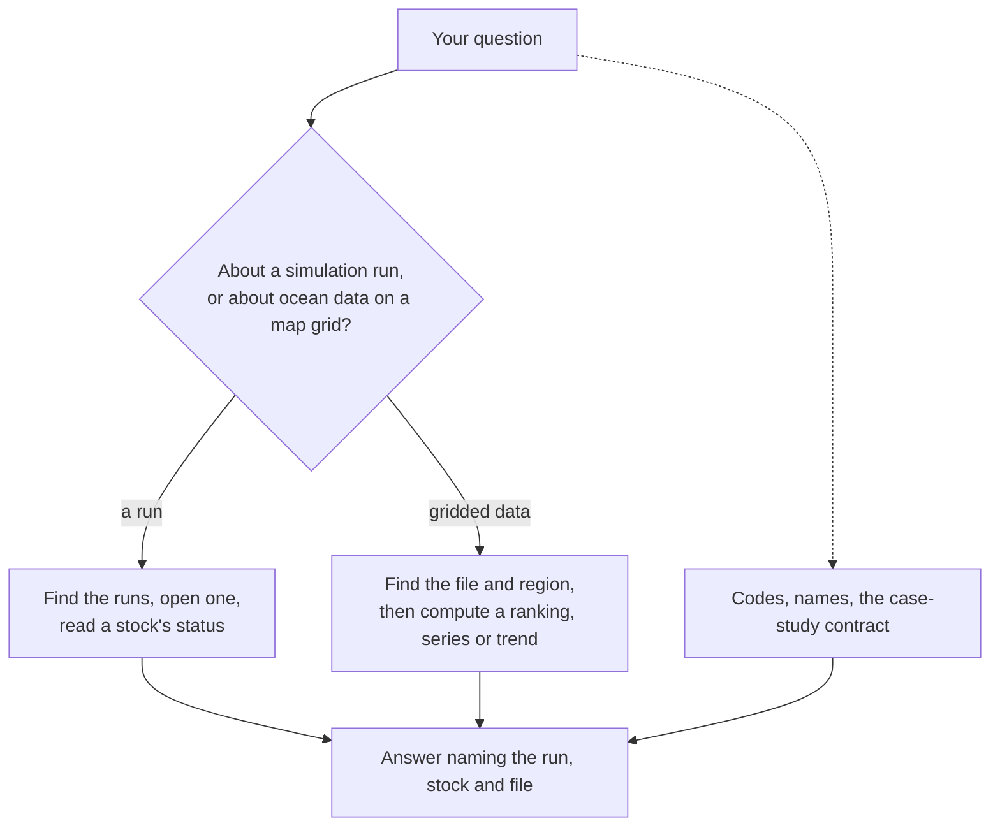

# What the SURIMI model server can do

SURIMI-model-mcp is the model server of SURIMI. It lets users ask about simulation runs and gridded model output, for example whether a stock is overfished in a run, and it has 26 tools. Users do not call the tools themselves. The LLM in the SURIMI chat picks the tools it needs for a question, and the server calculates the numbers. This page lists each tool with an example question, so that people can see what the chat can find out and what it cannot.

Tools marked "with calculation record" return a signed record of the number, which the `model_verify` tool or the data server's [audit page](https://project-surimi-surimi-data-mcp.lab.dive.edito.eu/audit) can check. The check covers the signature only, because the server does not calculate the number again.

How the server is built is described in [model_mcp_architecture.md](../model_mcp_architecture.md).

## 1. Simulation runs and stock status

| Tool | What it answers | Example question |
|---|---|---|
| `model_list_simulations` | The runs in SURIMI's storage, newest first, each with a one-line summary and, for stock assessments, the stock. | "Which simulation runs are there?" |
| `model_describe_simulation` | The files of one run and what can be read from them. | "What does run X contain?" |
| `model_get_artifact` | One file of a run. A text file comes back as text, and a picture or report comes back as a download link. | "Show me the configuration of run X." |
| `model_get_stock_status` | A stock's status from a CMSY++ stock assessment: B/Bmsy and F/Fmsy, each with its uncertainty range. The question must say whether it means the historical assessment or the simulated one. | "Is hake overfished according to the assessment?" |
| `model_get_stock_trajectory` | Year by year catch, fishing pressure and biomass of a stock from a CMSY++ assessment. | "How did the hake stock develop over the years?" |
| `model_explain_assessment_field` | What a column of a CMSY++ input or result file means. | "What is bt in the CMSY++ input?" |
| `model_run_stock_status` | B/Bmsy and F/Fmsy for each stock in a run's output file, and the Kobe quadrant of each stock. The file has no uncertainty range, and the tool says so. | "Which stocks are overfished in the latest output run?" |

## 2. Gridded data: what is there

| Tool | What it answers | Example question |
|---|---|---|
| `model_list_files` | The gridded data files, with their size, their variables and whether each is data or a region mask. | "Which gridded datasets are available?" |
| `model_list_regions` | The named regions in a region mask, with the number of grid cells in each. | "Which regions can I ask about?" |
| `model_describe_file` | What a file holds: its dimensions, variables, attributes and SHA-256 checksum. | "What is in this file?" |
| `model_list_variables` | The variables in a file, with their shapes, types and units. | "What is measured in this file?" |
| `model_get_time_range` | The start and end of a file's time axis. | "Which years does it cover?" |
| `model_get_spatial_bounds` | The latitude and longitude range a file covers, and its grid size. | "Which area does it cover?" |
| `model_check_cf_compliance` | Whether a file follows the CF conventions, the common standard for climate and ocean data. | "Does this file follow the CF conventions?" |
| `model_get_coverage_summary` | How many values of each variable are missing. | "How complete is this data?" |
| `model_validate_alignment` (with calculation record) | Whether a region mask sits on the same grid as the data. A mask on a different grid gives numbers for the wrong places, so this is checked first. | "Does this mask fit the data?" |

## 3. Gridded data: computing a result

| Tool | What it answers | Example question |
|---|---|---|
| `model_top_regions` (with calculation record) | The regions with the highest values, for one year. When no year is given, the latest year that has data is used. | "Where is biomass highest?" |
| `model_time_series` (with calculation record) | How a value develops over time in one region, with one row per year. | "How has biomass in the western Mediterranean changed?" |
| `model_compare_periods` (with calculation record) | The difference or the ratio between two periods, per region. | "How does the 2000s compare with the 1990s?" |
| `model_trend` (with calculation record) | Whether a value goes up, goes down or shows no trend, with a Mann-Kendall test and the slope. | "Is small demersal biomass declining?" |

## 4. Reference

| Tool | What it answers | Example question |
|---|---|---|
| `model_lookup_code` | The meaning of a species, gear or country code. | "What does HKE mean?" |
| `model_search_taxon` | The codes for a species name. | "What is the code for European hake?" |
| `model_get_contract` | The settings of the case study: area, period, time step and grid. | "Which period does the case study cover?" |
| `model_describe_ecosystem_model` | The model name, the tables and the functional groups of an Ecopath with Ecosim (EwE) model. | "Which species groups does the Ecopath model have?" |
| `describe_model_capabilities` | The data the server holds and the tools that read it. | "What can this server do?" |

## 5. Checking

| Tool | What it answers |
|---|---|
| `model_verify` | Whether a calculation record is genuine. The server checks the signature only and does not calculate the number again. |

## What the answers will not contain

- **A guessed region or stock.** Region names come from the mask file, and stocks come from the run.
- **Raw grid values in bulk.** The server summarises the grid on its side, so the LLM reads a short summary and not the grid.
- **A status presented as certain when it is not.** Where the file has no uncertainty range, or does not say which years were simulated, the answer says so.
- **An answer about a run that does not exist.** The server only answers about runs it found in storage.
