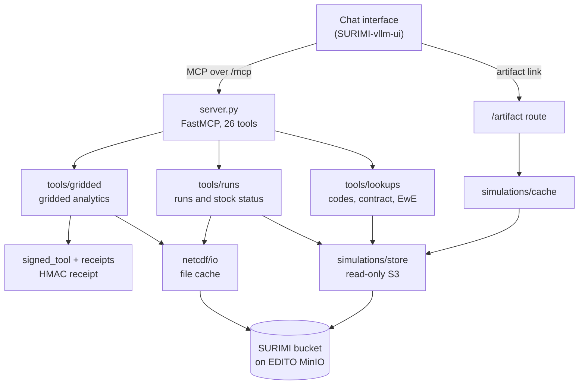
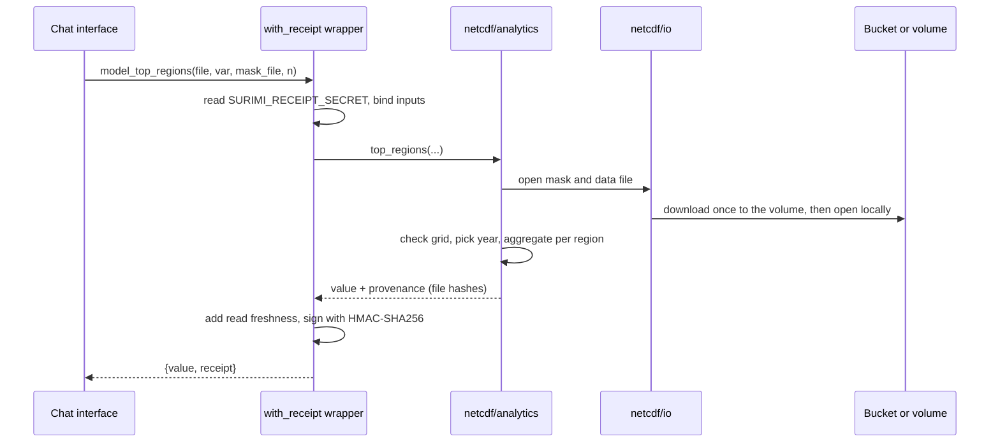

# SURIMI model MCP server: Architecture

This document is for developers and operators. The [README](README.md) gives the introduction for other readers, and [docs/tools.md](docs/tools.md) describes each tool and gives an example question.

## Overview

The model MCP server (SURIMI-model-mcp) lets users ask questions about what the SURIMI models produce, for example whether a stock is overfished in the latest experiment. It is the D3.9 deliverable. The chat that users type into, [SURIMI-vllm-ui](https://github.com/SURIMI-Project/SURIMI-vllm-ui), and the LLM service behind it, SURIMI-vllm, are supporting parts and not part of the deliverable. They are needed so that people can use the server in their own words.

The server reads three kinds of material from the SURIMI bucket on EDITO. These are the output files of SURIMI simulation runs, gridded NetCDF data with its region masks, and SURIMI's reference files (vocabularies, the case-study contract and the EwE model structure). It speaks the Model Context Protocol (MCP), so any MCP client can use it.

Take the question of whether a stock is overfished in the latest experiment. The LLM first calls `model_list_simulations` to find the runs, and then calls `model_run_stock_status` with the run it chose. The server reads the run's NetCDF file, works out each stock's position in the Kobe plot and returns the result. The LLM only reads that result and writes the answer.

The server holds no database. Every analysis runs on the server and returns an aggregated result (a "cube slice"), so the LLM never handles raw grid cells. Analytical results carry an HMAC-signed calculation record, called a receipt in the code, which anyone can check again with `model_verify`. Tabular observations such as catches, landings and fleet economics come from a separate server, [SURIMI-data-mcp](https://github.com/SURIMI-Project/SURIMI-data-mcp), and the chat attaches both at once.

The service is written in Python 3.12 on FastMCP 3.3.1, served by uvicorn and Starlette. It runs as one container on EDITO.

### Licence

EUPL-1.2.

---

## Responsibilities

- List the NetCDF files in the bucket and describe their structure: dimensions, variables, time range,
  spatial bounds, CF compliance and missing-value coverage.
- Load region masks and check that a mask shares the data file's latitude/longitude grid.
- Compute regional rankings, per-region time series, period comparisons and trends on the server.
- Sign each analytical result with an HMAC receipt, and check a receipt's signature on request.
- Discover simulation runs in the bucket without any per-model configuration.
- Describe a run and return its artifacts: text inline, binary files as a download link.
- Report stock status from CMSY++ result tables and from a run's NetCDF output (B/Bmsy, F/Fmsy and
  the Kobe quadrant).
- Answer reference questions: species, gear and country codes, taxon names, the case-study contract and
  the EwE model structure.
- Never write to the bucket.
- Keep answering after the EDITO storage token has expired, from copies on its own volume.
- List the questions it cannot answer, in capability records that the chat reads before it calls a tool.

### Build outputs

| Output | Description |
|---|---|
| `ghcr.io/surimi-project/surimimodelmcp:<version>` | Container image, started as `python -m surimi_model_mcp` and published by GitHub Actions. |

---

## Interfaces

The server registers 26 MCP tools from four modules in `surimi_model_mcp/tools/`. There are 14 in `gridded.py`, 7 in `runs.py`, 4 in `lookups.py` and `describe_model_capabilities` in `overview.py`. It registers no MCP resources or prompts. Five tools sign their result and the others return plain data.

### Transports

| Path | Protocol | Use |
|---|---|---|
| `/mcp` | Streamable HTTP | Preferred. The chat connects here. |
| `/sse`, `/messages` | Server-sent events | Kept for older MCP clients. |
| `/artifact/{simulation_id}/{filename}` | HTTP GET | Streams a binary artifact of a run from the server's cache. |

The server listens on port 26611 (`MCP_PORT`). The artifact route answers 404 when the run or the file is unknown or the file name is ambiguous, and 502 when the file cannot be fetched.

### Gridded data (`tools/gridded.py`)

| Tool | Signed | What it returns |
|---|---|---|
| `model_list_files` | | The NetCDF catalogue: each file's location, size and kind (data, mask or other). |
| `model_list_regions` | | The named regions in a mask file. |
| `model_describe_file` | | Dimensions, variables, attributes and the file's sha256. |
| `model_list_variables` | | Data variables with shapes, types and units. |
| `model_get_time_range` | | Start and end of the time axis. |
| `model_get_spatial_bounds` | | Latitude/longitude extent and grid size. |
| `model_check_cf_compliance` | | A CF-conventions check of the file. |
| `model_get_coverage_summary` | | Missing values per variable, as a count and a fraction. |
| `model_validate_alignment` | yes | Whether a mask and a data file share the same grid, and where they differ. |
| `model_top_regions` | yes | The top N regions by an aggregated value, optionally for one year. |
| `model_time_series` | yes | A per-region series as a summary plus per-year values, and raw points only for a requested window of at most 120 time steps. |
| `model_compare_periods` | yes | Two time ranges compared per region. |
| `model_trend` | yes | A Mann-Kendall trend test with a linear slope. |
| `model_verify` | | Whether a receipt's signature is valid. |

### Simulation runs (`tools/runs.py`)

| Tool | What it returns |
|---|---|
| `model_list_simulations` | The runs found in the bucket, newest first, optionally for one model. |
| `model_describe_simulation` | A run's artifacts and the metadata parsed from them. |
| `model_get_artifact` | One artifact: text inline up to 64 KiB, a binary file as an `/artifact/...` link. |
| `model_get_stock_status` | CMSY++ stock status with reference points and 2.5th/97.5th percentile bounds. |
| `model_get_stock_trajectory` | Year by year catch, F/Fmsy and biomass from a CMSY++ result table. |
| `model_explain_assessment_field` | The meaning of a CMSY++ input or result column. |
| `model_run_stock_status` | B/Bmsy and F/Fmsy per stock from a run's NetCDF, with its Kobe quadrant. |

### Reference layer (`tools/lookups.py`)

| Tool | What it returns |
|---|---|
| `model_lookup_code` | The meaning of an FAO species, ISSCFG gear or ISO country code. |
| `model_search_taxon` | Codes for a species name, searched across ASFIS, WoRMS and FishBase. |
| `model_get_contract` | The north-western Mediterranean case-study contract: name, period, time step, grid and the code standards it uses. |
| `model_describe_ecosystem_model` | The tables and functional groups of an EwE model file (`.eiixml`). |

### Capabilities (`tools/overview.py`)

`describe_model_capabilities` lists each data source the server holds, the tools that read it and the questions it cannot answer. Each unanswerable question carries a reason, which is `not_served`, `not_collected` or `no_mechanism`.

---

## Model theory

The server does not run a model. It reads what the SURIMI models wrote and calculates summaries of it.

**Simulation runs.** Any object in the bucket whose path holds a UUID directory, or a flat `<uuid>_name` file, belongs to a run. The first path segment names the model and the first UUID is the run id, so a model appears as soon as it writes its first run. Discovery leaves out the infrastructure prefixes `mcp_data/`, `surimi_data/`, `surimi_docs/`, `hive/`, `processed/`, `raw/` and `surimi_data_dummy/`. Parsers for run metadata exist for CMSY++ and the market model, and the other models list their artifacts without parsed metadata.

**Stock status from a run's NetCDF.** `model_run_stock_status` opens the run's NetCDF file and reads the variables `stock_status` (B/Bmsy) and `exploitation` (F/Fmsy) on `(year, species)`. The file carries no units or labels for these two variables, and it does not say which years are historical and which are simulated. The tool states both limits in its answer. It drops the fill values at the start of each series, skips years where either value is missing and gives no uncertainty bounds. The Kobe position is one of four labels: healthy, overfished (B/Bmsy below 1), subject to overfishing (F/Fmsy above 1), or overfished and subject to overfishing.

**Stock status from CMSY++ results.** `model_get_stock_status` and `model_get_stock_trajectory` read the CMSY++ result table and report reference points with the 2.5th and 97.5th posterior percentiles. The caller must name the phase, `historical` or `simulation`. A run whose only result file does not say which phase it holds is refused for both phases.

**Gridded data.** Files are read with xarray. A region mask is a NetCDF file with a `region` variable of weights on `(region, lat, lon)`. Analyses apply the mask cell by cell and never re-project it, so a mask on a different grid would give plausible numbers for the wrong cells. `model_validate_alignment` checks this before a result is trusted. Values are aggregated as mean, sum, maximum or minimum. When a file has an extra dimension that the caller has not fixed, the result averages over it and names the dimension in `unselected_dims`.

**Trend.** `model_trend` runs a Mann-Kendall test with tie correction and fits a linear slope. It reports an increasing or decreasing trend when p is below 0.1 and needs at least three points. It also returns the lag-1 autocorrelation and the effective sample size, and sets `independence_assumed` to true because it applies no correction for them.

**Receipts.** A receipt holds the tool name, its inputs, its output, a timestamp and, where the tool returns one, the provenance (file hashes and how fresh the read was). It is signed with HMAC-SHA256 over canonical JSON. The key, `SURIMI_RECEIPT_SECRET`, is shared with the data server, so one verify flow serves both. `model_verify` checks the signature only and reports `verification_method` as `signature_only`, because no tool of this server can recompute its number.

---

## Service architecture

The code is one package, `surimi_model_mcp/`. `mcp_server.py` holds the FastMCP instance, `sources.py` holds the capability records and `tools/` holds the 26 tools. `server.py` registers the tools, and its `main()` runs a drift check (every tool must belong to a declared source), starts three background threads that copy files to the local volume, and serves the app. `python -m surimi_model_mcp` calls `main()`. `app_factory.py` builds one Starlette app that holds the `/mcp` and `/sse` transports and the artifact route. The tools sit on two storage layers, `netcdf/` for gridded files and `simulations/` for runs, and each has its own cache.

### High-level architecture



### Request flow for a signed tool



### Start-up

1. Register the capability records and the 26 tools, then run the drift check. A mismatch is logged as a warning and does not stop the server.
2. Start three daemon threads: `nc-prefetch` copies every NetCDF file under the catalogue prefix,
   `sim-prefetch` copies the files of every discovered run, and `ref-prefetch` copies the reference
   files. All three are skipped when no storage endpoint is set.
3. Serve. Requests are answered before the copies finish, and until then a tool downloads what it needs.

### Key design decisions

| Decision | Rationale |
|---|---|
| Streamable HTTP at `/mcp` as well as SSE | The chat connects to `/mcp` directly, without an SSE bridge. SSE stays for older clients. |
| Read-only storage enforced in code | `simulations/store.py` exposes only four read operations (`find`, `info`, `cat_file`, `sign`) and keeps the underlying file system out of reach. A test also searches the package for write calls. |
| Binary artifacts streamed by the server | Presigned storage links expired with the storage token while cached text kept working. The server streams the bytes from its own copy. |
| Artifact file names matched against the run's own list | A request can only fetch a file that discovery found in that run. |
| One lock around every NetCDF read | Concurrent opens crashed the HDF5 library on 28 September 2026, so the 14 gridded tools and `model_run_stock_status` run one at a time. |
| Copies never invalidated | A cached file is kept and its age travels in the signed provenance, so a reader can see how fresh the number is. |
| Raw series withheld by default | `model_time_series` returns raw points only for a requested window. A window over 120 steps is refused and not cut. |
| Trend correction reported, not applied | The choice of autocorrelation correction is left to the domain reviewers. |

---

## Error handling

- Simulation tools return `{"error": "...", "stale", "note", "partial", "partial_note"}` instead of raising, so the chat sees why a call failed and whether its data was stale. Reference tools return `{"error": "..."}` in the same way.
- Gridded tools raise a named error (`AnalyticsError`, `NetCDFIOError` or `RegionMaskError`), and the MCP framework returns it to the client.
- A signed tool refuses to run without `SURIMI_RECEIPT_SECRET`. `model_verify` answers `secret_not_configured` in that case.
- An expired or invalid storage credential is reported as a credential fault and not as a missing file. The message says that the server's S3 credentials are invalid or expired.
- When the bucket cannot be listed, the server returns the last good listing with `stale: true` and a note. It retries a failed listing at most every 30 seconds.
- A run whose files cannot all be read is returned with `partial: true` and a note. A truncated file never produces a derived value.
- The gridded catalogue reads `netcdf/` first and falls back to the legacy `NetCDF/` prefix with a note. Setting `SURIMI_NETCDF_PREFIX` turns the fallback off.

---

## Logging

- The server prints its events (start-up, drift check, copy progress, warnings) to standard output with the prefix `[surimi-model-mcp]`.
- The modules under `simulations/`, `reference/warm.py`, `netcdf/analytics.py` and `tools/runs.py` use Python's `logging` for warnings.
- `faulthandler` is on, so a crash inside a C library prints the Python stack of every thread.

---

## S3 bucket

The server reads the SURIMI bucket on EDITO MinIO (`project-surimi`, endpoint
`https://minio.dive.edito.eu`) and never writes to it.

| Path | Content |
|---|---|
| `netcdf/` (legacy `NetCDF/`) | Gridded NetCDF data and region masks. |
| `<model>/.../<uuid>/...` | Simulation run artifacts, found by discovery. |
| `ecopath/` | Vocabulary files (ASFIS, ISSCFG, WoRMS, FishBase, ISO-3166) and EwE model files. |
| `controller/<case study>/*_contract.yaml` | The case-study contract. |

The repository's `data/netcdf-samples/` holds the region mask of the western Mediterranean sample. The sample data file is not distributed with the repository; a local copy placed in that folder is listed next to the mask. The image includes neither, so on EDITO the listing names only the files in the bucket.

### Local copies

| Directory | Content |
|---|---|
| `SURIMI_NC_CACHE` (`/data/nc-cache`) | NetCDF files and saved catalogue listings. |
| `SURIMI_SIM_CACHE` (`/data/sim-cache`) | Run artifacts and the saved run listing. |

Both sit on one persistent volume, so a restart keeps them. The server writes each copy to a temporary file and then renames it, so a reader never sees half a file.

### S3 bucket authentication

The EDITO launcher injects a temporary storage token (valid about 24 hours) into the Secret
`<release>-s3`.

| Variable | Purpose |
|---|---|
| `AWS_ENDPOINT_URL` | MinIO endpoint. When unset the server runs in local mode and skips all copying. |
| `AWS_ACCESS_KEY_ID` | Access key. |
| `AWS_SECRET_ACCESS_KEY` | Secret key. |
| `AWS_SESSION_TOKEN` | Temporary session token. |

The server cannot renew the token. After the token expires, the server answers from its local copies and marks answers older than 24 hours as stale. It cannot see runs written after the expiry until it is relaunched with a fresh token.

---

## Kubernetes

The server runs as one pod on EDITO, launched from the `surimi-model-mcp` chart in the EDITO service catalogue (`service-playground`).

| Item | Value |
|---|---|
| Image | `ghcr.io/surimi-project/surimimodelmcp:<version>` |
| Port | 26611, service name `mcp` |
| Ingress | `/mcp`, `/sse`, `/messages` and `/`, with TLS; read timeouts of one hour for streaming |
| Volume | 5 Gi persistent volume, mounted at `/data/nc-cache` and `/data/sim-cache` |
| Update strategy | `Recreate`, because the volume can be attached to one pod at a time |
| Probes | TCP checks (the MCP paths are streaming endpoints) |
| Resources | Request 200m CPU and 512 Mi memory; limit 2 CPU and 4 Gi memory |
| Secrets | `<release>-s3` (storage token) and `<release>-receipts` (receipt key, kept across upgrades) |

The chart takes the receipt key from the release's own secret, or else from another secret in the namespace that holds `SURIMI_RECEIPT_SECRET`, so the model server and the data server sign with the same key.

---

## Environment variables

| Variable | Default | Purpose |
|---|---|---|
| `MCP_PORT` | `26611` | Listening port. |
| `SURIMI_RECEIPT_SECRET` | none | HMAC key for receipts. Required for signed tools. |
| `AWS_ENDPOINT_URL` | none | Storage endpoint; unset means local mode. |
| `AWS_ACCESS_KEY_ID`, `AWS_SECRET_ACCESS_KEY`, `AWS_SESSION_TOKEN` | none | Storage credentials. |
| `SURIMI_SIM_BUCKET` | `project-surimi` | Bucket holding runs and reference files. |
| `SURIMI_NETCDF_PREFIX` | `s3://project-surimi/netcdf/` | Gridded catalogue prefix. Setting it disables the legacy fallback. |
| `SURIMI_NETCDF_REFERENCE_DIR` | `data/netcdf-samples` under the repository root | Directory of the sample files (present in the repository, not in the image). |
| `SURIMI_LOCAL_NETCDF_SAMPLES` | unset | An extra local directory of NetCDF files. |
| `SURIMI_NC_CACHE` | `/tmp/surimi-s3cache` | Local copies of NetCDF files and listings. The chart sets it to `/data/nc-cache`. |
| `SURIMI_SIM_CACHE` | `/tmp/surimi-simcache` | Local copies of run artifacts. The chart sets it to `/data/sim-cache`. |
| `SURIMI_SIM_STATE` | `SURIMI_NC_CACHE`, else `/tmp/surimi-s3cache` | Where the run listing is saved. |
| `SURIMI_PUBLIC_BASE_URL` | empty | Absolute base for artifact links. Empty gives links relative to the server. |

---

## CI/CD

### GitHub Actions

| Workflow | Trigger | What it does |
|---|---|---|
| **Tests** (`test.yml`) | Push to `master`, pull request, manual, or called by another workflow | Installs the dependencies on Python 3.12, runs `PYTHONPATH=. python -m pytest -q`, and checks that each tool listed in `gridded`, `runs` and `lookups` is defined and named `model_*`. |
| **Build and Push Docker Image** (`docker.yml`) | Push to `master`, tag `v*`, manual | Runs the tests first, then builds the image and pushes it to the GitHub Container Registry. |

### Docker image

The image is built from `python:3.12-slim` and pushed as `ghcr.io/surimi-project/surimimodelmcp`. Every build is tagged `latest`, and a push of the tag `v<version>` adds the tag `<version>`. The EDITO chart pins a version tag.

---

## Technology stack

| Package | Role |
|---|---|
| `fastmcp` 3.3.1 | MCP server framework. |
| `uvicorn`, `starlette` | Web server and the combined app with the artifact route. |
| `xarray` | NetCDF reading and aggregation. |
| `netcdf4`, `h5py`, `h5netcdf` | NetCDF and HDF5 back ends. |
| `numpy` | Array arithmetic and the trend statistics. |
| `s3fs` | Read access to EDITO MinIO. |
| `pyyaml` | Reading the case-study contract. |
| `pytest`, `pytest-asyncio` | Tests. |

Only `fastmcp` is pinned. The `Dockerfile` and the test workflow list the dependencies, and there is no `requirements.txt`.

---

## Project structure

```
SURIMI-model-mcp/
├── surimi_model_mcp/
│   ├── __main__.py        # python -m surimi_model_mcp
│   ├── server.py          # tool registration, start-up copies, main(): drift check and uvicorn
│   ├── mcp_server.py      # the FastMCP instance and the log line
│   ├── sources.py         # capability records: what is served, what cannot be answered
│   ├── capabilities.py    # registry code: describe(), drift check
│   ├── app_factory.py     # Starlette app: /mcp, /sse, /messages and the /artifact route
│   ├── paths.py           # APP_ROOT, the repository or /app
│   ├── tools/             # gridded (14), runs (7), lookups (4), overview (1)
│   ├── provenance/        # receipts (canonical JSON, HMAC-SHA256), signed_tool (with_receipt, read freshness)
│   ├── netcdf/            # analytics, io (cache and lock), inspect, regions, discovery
│   ├── simulations/       # store (read-only S3), discovery, cache, parsers, cmsy_result, run_status
│   └── reference/         # vocab, contract, ewe, warm (start-up copy)
├── data/netcdf-samples/   # Region mask of the local sample (not in the image)
├── scripts/               # Mask builder and a live check for simulation discovery
├── tests/                 # pytest suite
├── Dockerfile
└── .github/workflows/     # test.yml, docker.yml
```

---

## Source control

The code is in Git on GitHub at
[SURIMI-Project/SURIMI-model-mcp](https://github.com/SURIMI-Project/SURIMI-model-mcp), with `master` as the
default branch. A push of a tag `v<version>` builds the image with the tag `<version>`, which is the tag the EDITO chart pins.

---

## Testing

Tests live in `tests/` (48 test files) and use pytest with pytest-asyncio. The fixtures write small NetCDF files, so the NetCDF write back ends (`netcdf4`, `h5py` and `h5netcdf`) must be installed.

```bash
python3 -m venv .venv
.venv/bin/pip install fastmcp==3.3.1 uvicorn starlette xarray netcdf4 h5py h5netcdf numpy s3fs pyyaml pytest pytest-asyncio
PYTHONPATH=. .venv/bin/python -m pytest -q
```

`tests/test_dockerfile.py` checks that the image copies the whole package and starts it with `python -m`. `tests/test_every_import_resolves.py` resolves every import in the package, and `tests/test_sim_store.py` checks that no storage write call has entered the package.

Run the server locally without storage (local mode, bundled samples only):

```bash
PYTHONPATH=. .venv/bin/python -m surimi_model_mcp
# MCP endpoint: http://localhost:26611/mcp
```
